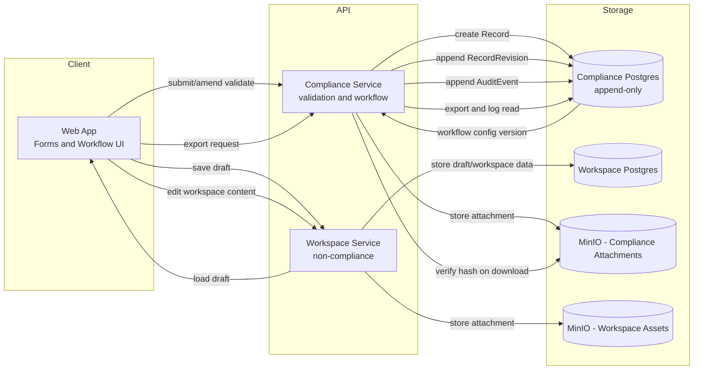

# Compliance Plan

## Purpose

Define how the system supports audit‑grade incident and inspection records while preserving free-form, flexible editing for non‑regulated content.

---

## Scope

**Applies to:** Databases flagged as `complianceMode = true` (e.g. incident reports, inspections, safety logs).
**Excludes:** Freeform pages, wikis, notes, and non‑compliance databases.

---

## Core Principles

* **Immutability:** Submitted records are never overwritten.
* **Append‑only history:** All changes create new facts, never edits.
* **Traceability:** Every action is attributable to a user and time.
* **Workflow enforcement:** State transitions are controlled and auditable.
* **Separation of concerns:** Flexible schemas, strict compliance core.

---

## Data Model

### Record

* Stable identity for a compliance item.
* Holds lifecycle state and pointer to latest revision.

### RecordRevision

* Immutable snapshot of all field values (`jsonb`).
* Created on submission or amendment.
* Linked to the Record and creator.

### AuditEvent

* Append‑only log of actions (create, submit, amend, transition, close).
* Captures actor, timestamp, event type, and metadata.

### Attachments

* Stored as immutable blobs (content‑addressed by hash).
* Linked to records and revisions; never replaced.

---

## Record Lifecycle

1. **Draft** – Editable.
2. **Submitted** – Locked; changes require amendment (new revision).
3. **In Review / Investigating** – Controlled transitions only.
4. **Closed (Sealed)** – No edits; reopen only via audited transition.

---

## Editing Rules

* Drafts may be edited freely.
* Post‑submission changes create a **new revision** and require a reason.
* No destructive updates or silent overwrites.

---

## Workflow Enforcement

* Allowed states and transitions defined per database.
* Transitions may require roles, fields, or attachments.
* Validation enforced server‑side.

---

## Proposed Compliance Architecture Diagram



---

## Audit Guarantees

* All mutations routed through a single compliance service.
* Database transactions ensure atomic revision + audit creation.
* No privileged bypass paths.

---

## Exports & Reporting

* Latest revision + full audit trail exportable (PDF/CSV).
* Exports are read‑only representations of immutable data.

---

## Security & Access

* Authenticated users only.
* Role‑based permissions for viewing, amending, and transitioning records.

---

## Non‑Goals (Initial Phase)

* Cryptographic signing chains.
* WORM storage enforcement.
* External regulatory certifications.

(These may be added in later phases.)

---

## Status

**Version:** 1.0 (Initial)
**Intent:** Internal audit‑grade compliance for incident and inspection records.

---

## Decisions (Pending)

1. **Schema snapshots:** Use **schema versioning** (RecordRevision stores `schemaVersionId`; SchemaVersion captures field definitions on change).

2. **DB‑level immutability:** Use a **separate PostgreSQL database** for immutable compliance records, with append‑only enforcement at the DB layer (app role has `SELECT` + `INSERT` only on revision/audit tables; deny `UPDATE/DELETE`; add trigger to reject updates/deletes as a safety net).

3. **Amendment reasons & approvals:** Default policy: initial submit does **not** require reviewer/approval; amendments require a **reason**; reviewer + approval required on **Review/Close/Seal** transitions.
4. **Policy precedence:** Database policy is the minimum compliance baseline; forms may be stricter but never looser; enforce server‑side.
5. **Transition requirements:** Default mapping: Submit (none), Amend (reason), Review (reviewer), Close/Seal (reviewer + approval), Reopen (reason + approval). Configurable per database.
6. **Read access logging:** Log exports and revision views (not every list view) to reduce noise; expand later if needed.
7. **Retention & legal holds:** Default to **indefinite retention**; if a policy is later added, the clock starts at **Close/Seal**; **archive only** (no delete). Legal holds prevent archiving.
8. **Attachment integrity:** Use SHA‑256 hashes stored with attachments; include hash in RecordRevision snapshot; store in a **separate MinIO (S3‑compatible) instance** from general workspace assets; verify hash on **every download**; no overwrites (new attachment per revision).
9. **Workflow config schema:** Use a **JSON workflow config** with immutable versioning (WorkflowVersion stores config JSON). Records/Revisions reference `workflowVersionId`. Plan to migrate to normalized tables later by backfilling states/transitions per version.

Example default workflow config:

```json
{
  "states": [
    { "id": "draft", "label": "Draft" },
    { "id": "submitted", "label": "Submitted" },
    { "id": "review", "label": "In Review" },
    { "id": "closed", "label": "Closed/Sealed" }
  ],
  "transitions": [
    { "from": "draft", "to": "submitted", "guards": [] },
    { "from": "submitted", "to": "review", "guards": [{ "type": "role", "value": "reviewer" }] },
    { "from": "review", "to": "closed", "guards": [{ "type": "role", "value": "reviewer" }, { "type": "approval" }] },
    { "from": "closed", "to": "review", "guards": [{ "type": "reason" }, { "type": "approval" }] }
  ]
}
```
